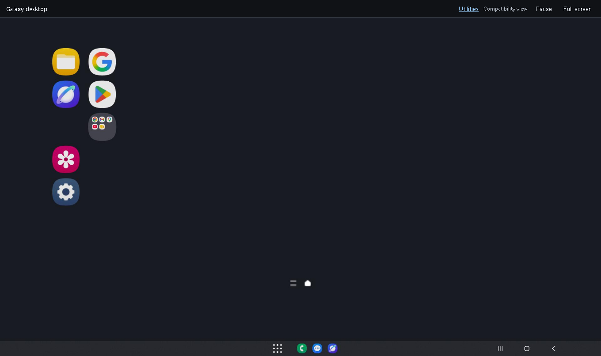
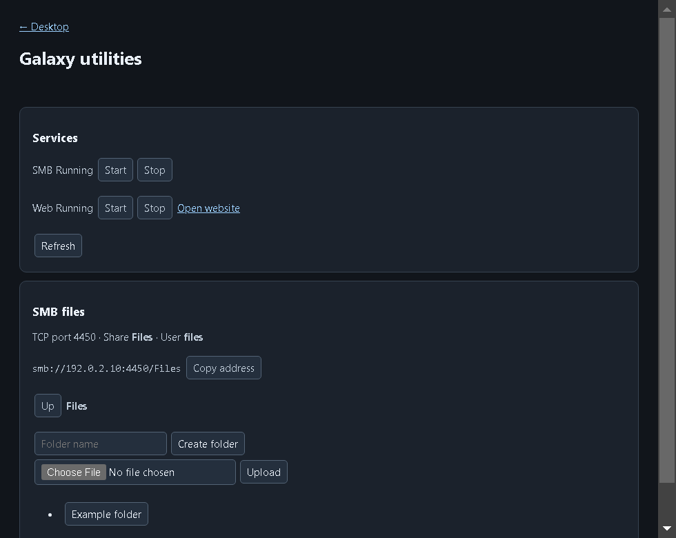

# Galaxy LAN Desktop

Turn a spare Samsung phone into a desktop you can open in a browser on your LAN. Use your keyboard and mouse to run Android apps, or open **Utilities** to share files over SMB and host a static website. No root, TV, or HDMI adapter required.



[Install the APK](docs/phone-setup.md) · [Install with USB scripts](#quick-start) · [Using the desktop](#using-the-desktop)

**Tested on** Galaxy S22 Ultra (SM-S908U1), Android 14. The installer requires Android 14 and ARM64. Display and input behavior may vary on other models or firmware.

## Install on the phone

Download the signed APK from [GitHub Releases](https://github.com/IAmStoxe/galaxy-lan-desktop/releases), then follow the [setup guide with screenshots](docs/phone-setup.md). Pair the app once through Android Wireless debugging. The dashboard switches the browser desktop, SMB share, and web server on or off independently and shows the address for each running service.

The APK bundles the desktop and server binaries. The USB installers below remain available for building from source or automating setup.

## Quick start

1. Install **Go 1.25+**, a **JDK** (tested with JDK 11), and the Android SDK with **Platform-Tools**, **SDK Platform 34**, and **Build-Tools 34.0.0**. Set `ANDROID_HOME` and `JAVA_HOME` if they aren’t detected.
2. Enable **USB debugging** under the phone’s **Developer options**, connect it by USB, and approve the computer. Put the phone and the computer you’ll use to view it on the same trusted Wi-Fi network.
3. From the repository directory, run the installer for your OS.

   **Linux / macOS** with Bash and curl

   ```bash
   bash ./install.sh
   ```

   **Windows** with PowerShell 7

   ```powershell
   pwsh -File .\Install.ps1
   ```

4. Open the HTTPS address printed by the installer. Sign in as `dex` with the password generated on the phone.

   ```sh
   adb shell cat /data/local/tmp/galaxy-lan-desktop/dex-password
   ```

If ADB sees more than one device, use `adb devices` to find the right serial. Pass `--serial YOUR_SERIAL` (Bash) or `-Serial YOUR_SERIAL` (PowerShell), and add `-s YOUR_SERIAL` to the ADB commands below.

<details>
<summary>Browser certificate and installer flags</summary>

The desktop serves HTTPS with a self-signed certificate. Verify its SHA-256 fingerprint against the certificate pulled over USB before trusting it.

```sh
adb pull /data/local/tmp/galaxy-lan-desktop/dex-cert.pem
openssl x509 -in dex-cert.pem -noout -sha256 -fingerprint
```

On Windows, you can use `certutil -decode dex-cert.pem dex-cert.cer` followed by `certutil -hashfile dex-cert.cer SHA256`.

| What you want | Bash | PowerShell |
| --- | --- | --- |
| Install the Quick Settings tile | `--with-tile` | `-WithTile` |
| Build without connecting a phone | `--build-only` | `-BuildOnly` |
| Install without starting services | `--no-start` | `-NoStart` |

</details>

## Using the desktop

Click inside the desktop to send keyboard and mouse input to the phone. Use **Full screen** when you want the whole monitor. **Pause** stops streaming to the current browser tab. The Quick Settings tile turns the desktop service off for everyone.

### Files and services

Open **Utilities** from the desktop toolbar. The panel can start or stop SMB and the web server independently. You can create folders and upload or download files without leaving the browser. Browser uploads are limited to 64 MiB per file.



| Service | LAN address | Access |
| --- | --- | --- |
| Desktop and Utilities | `https://PHONE_IP:8443/` | `dex` with the generated desktop password |
| SMB Files share | `smb://PHONE_IP:4450/Files` | `files` with its own generated password |
| Static website | `http://PHONE_IP:8080/` | Read access for devices on the LAN |

Use an SMB client that supports custom TCP ports and SMB signing and encryption. The share lives in the phone’s `GalaxyLANShare` folder.

```sh
adb shell cat /data/local/tmp/galaxy-lan-desktop/smb-password
```

To host a page, put it in the dedicated web directory. Other devices on the LAN can read files you put there.

```sh
adb push ./index.html /data/local/tmp/galaxy-lan-desktop/www/index.html
```

## Quick Settings tile

In the phone app, tap **Add DeX Browser tile**. USB installers can also add it with `--with-tile` or `-WithTile`. Tap **DeX Browser** in Quick Settings to toggle the desktop. To start it from the tile after a reboot without USB, pair the tile’s local controller once. APK users can follow the [phone setup guide](docs/phone-setup.md) for pairing.

1. Enable **Wireless debugging** and approve your trusted Wi-Fi network.
2. With USB connected, run `bash ./pair-tile.sh --serial YOUR_SERIAL` or `pwsh -File .\Pair-Tile.ps1 -Serial YOUR_SERIAL`.
3. Open **Pair device with pairing code** on the phone. Keep that dialog open while you enter its port and six-digit code at the script’s prompts.

Pairing allows the tile to enable Wireless debugging when its helper is unavailable. To revoke access, forget its pairing in Developer options and disable Wireless debugging. Keep the generated signing files under `.build` and use the same installer for tile upgrades. A new key requires uninstalling the old tile and pairing again.

## Restart the services

After a phone reboot, start the web and SMB services over USB. Start the desktop with the tile or the second command below. If the phone changed IP addresses while services were running, use `stop` before restarting.

```sh
adb shell sh /data/local/tmp/galaxy-lan-desktop/lan-services.sh start
adb shell sh /data/local/tmp/galaxy-lan-desktop/lan-services.sh browser-on
```

The script also accepts `status`, `browser-off`, and `stop`. Reinstalling keeps the website, share contents, and generated credentials.

## Dependencies

The source installer downloads [GoSamba v1.3.8](https://github.com/ahmetozer/gosamba/releases/tag/v1.3.8) and, for the phone app and tile, the ARM64 ADB binary from [LADB](https://github.com/tytydraco/LADB/tree/60f48029cf9d8e0bc848ca41a7bd76694d4ab796). It verifies pinned SHA-256 hashes and caches the downloads under `.build`. The APK includes their license notices, which are also visible from **Open-source licenses**. The repository itself is [MIT-licensed](LICENSE).
