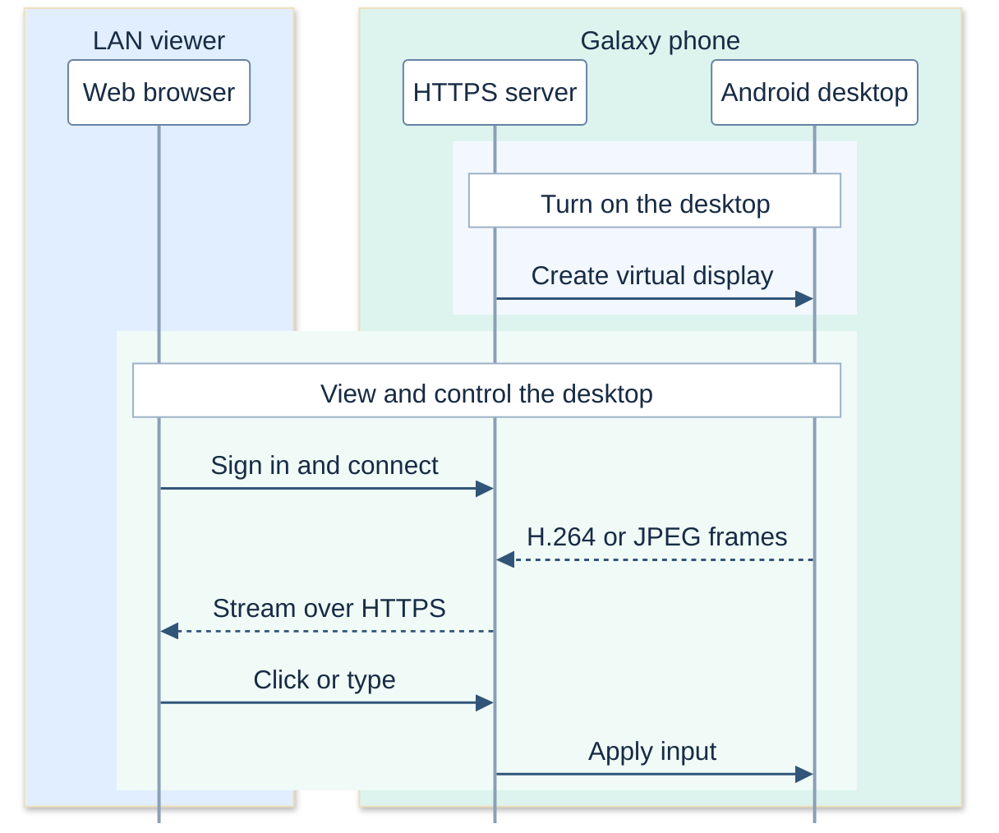

# How Galaxy LAN Desktop works

The Galaxy phone runs the Android apps and hosts everything on its Wi-Fi address. The browser receives pictures of a separate virtual desktop and sends mouse and keyboard input back to that display.

## What pairing does

For APK setup, you approve Android’s Wireless debugging pairing on the phone. The app’s bundled ADB client connects back to the same phone on `127.0.0.1`. That gives it an authorized Android shell with which to install the bundled files and control the services. The USB installers use the shell over an approved USB debugging connection. Both paths require your approval and work without root. [Android’s ADB guide](https://developer.android.com/tools/adb#connect-to-a-device-over-wi-fi) · [App controller](../../src/tile/WirelessController.java)

Once the desktop is running, the browser connects on port `8443` over HTTPS with the desktop password.

## Explore by topic

- [Browser desktop](browser-desktop.md) explains the virtual display, streaming, and input.
- [LAN services](lan-services.md) explains the ports, passwords, service switches, and stored files.
- [Phone setup](../phone-setup.md) walks through APK installation and pairing with screenshots.
