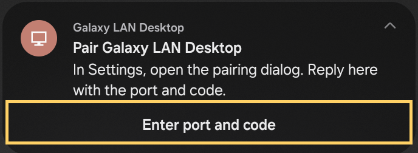
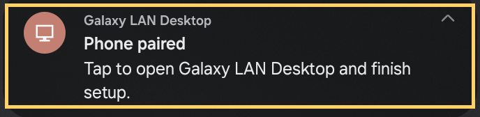
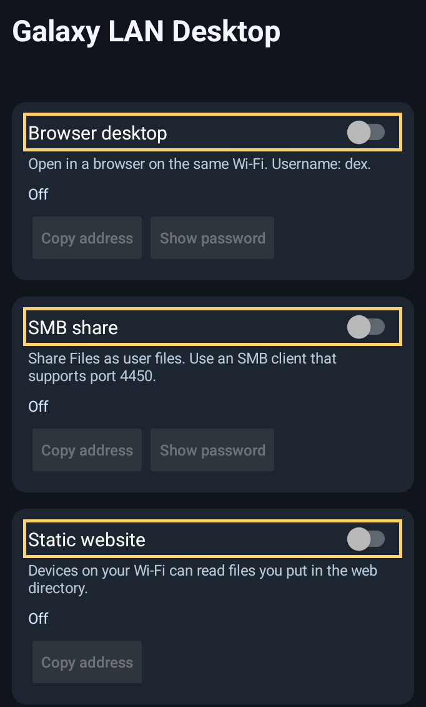

# Set up Galaxy LAN Desktop on your phone

This guide uses a Galaxy S22 Ultra running Android 14. The APK needs Android 14, ARM64, and Wi-Fi. You can complete setup on the phone itself. For building from source or setting up over USB, see the [Bash and PowerShell installers](../README.md#quick-start).

## 1. Install the APK

1. On your phone, open [GitHub Releases](https://github.com/IAmStoxe/galaxy-lan-desktop/releases) and download the `arm64.apk` file under **Assets**.
2. Open the downloaded file and tap **Install**. If Android asks whether the app you downloaded it with can install an app, confirm only if you downloaded this APK from the project’s release page.
3. Open **Galaxy LAN Desktop**.

If **Developer options** is hidden, go to **Settings → About phone → Software information**, tap **Build number** seven times, and enter your screen lock if prompted. [Samsung’s Developer options guide](https://developer.samsung.com/health/data/guide/phone-developer-options.html)

## 2. Pair the phone once

1. In Galaxy LAN Desktop, tap **Pair using a notification**. Allow notifications when asked. The app opens **Developer options**.
2. Tap **Wireless debugging**, turn it on, and allow it on your trusted Wi-Fi. Tap **Pair device with pairing code**. Leave this dialog open.
3. Note the **port**, which is the number after the colon on the **IP address & Port** line, and the **six-digit pairing code**. Swipe down from the top of the screen. Expand the **Pair Galaxy LAN Desktop** notification and tap **Enter port and code**.

   

4. Enter the two numbers with one space between them. For example, `43123 012345`. Use the numbers on your own screen. Tap **Send**.
5. Tap **Phone paired** to return to the app and finish setup.

   

If notifications are disabled, choose **Pair using split screen** in the app. Open the app and Settings side by side, keep Android’s pairing dialog open, enter the port and code in the app, and tap **Pair and finish setup**.

## 3. Turn on the services you want

The dashboard has three independent switches. Starting the browser desktop leaves file sharing and web hosting off until you enable them.

| Switch | How to connect |
| --- | --- |
| **Browser desktop** | Turn it on, tap **Copy address**, and open that HTTPS address in a browser on the same Wi-Fi. Sign in as `dex`. Use **Show password** for the generated password and certificate fingerprint. Compare the fingerprint with the browser’s certificate before continuing past its self-signed certificate warning. |
| **SMB share** | Turn it on and use **Copy address** in a client that supports SMB on custom TCP port `4450`. The share is `Files` and the username is `files`. Use **Show password** for its separate password. |
| **Static website** | Turn it on and open the copied HTTP address on port `8080`. Devices on your Wi-Fi can read anything you publish there. See [website files](../README.md#files-and-services) for replacing the default page. |

In the desktop browser, **Utilities** gives you another way to control SMB and the website or manage files in the share. Turning off the SMB service keeps the files on the phone.

## After setup

- **Quick Settings.** Tap **Add DeX Browser tile** in the app to add a switch for the desktop. The main app still controls all three services.
- **After restarting.** Open the app to start the services you want. If Android has turned off Wireless debugging, turn it back on for your trusted Wi-Fi and tap **Refresh status**. Pair again only if the phone forgot the previous authorization.
- **To remove access.** Switch off the services, open **Wireless debugging**, forget the app under **Paired devices**, and turn Wireless debugging off when you no longer need it.
